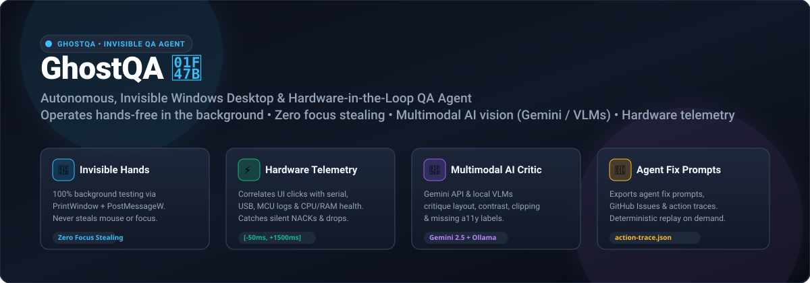
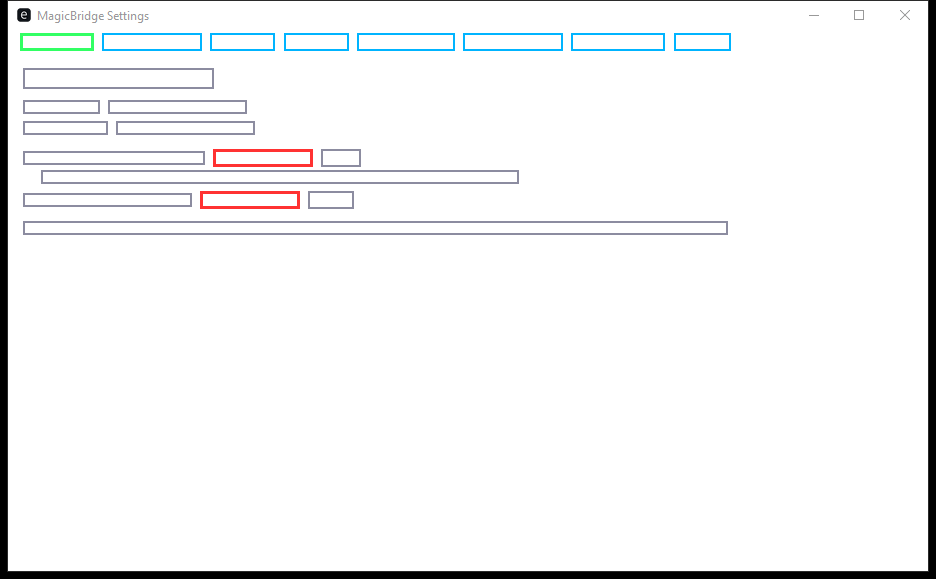
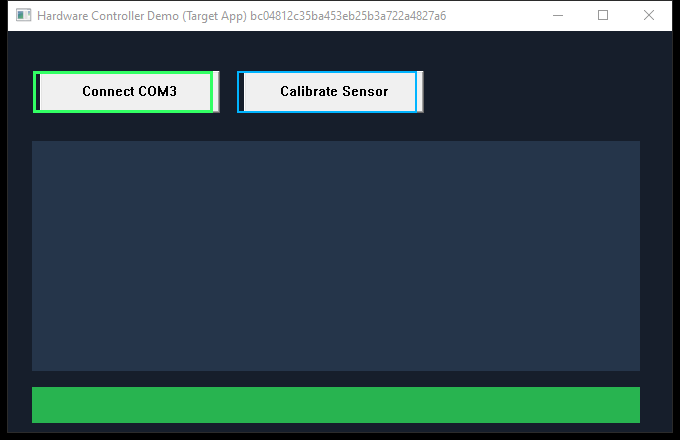
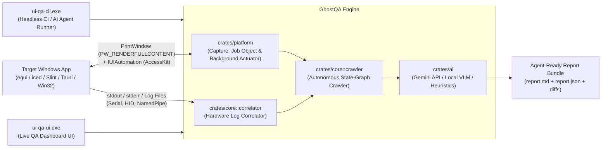

<div align="center">



# GhostQA 👻 🔬

### Autonomous, Invisible Windows Desktop & Hardware-in-the-Loop (HIL) QA Agent

**Hands-free UI exploration, background frame capture, real-time hardware telemetry correlation, and Multimodal AI vision critique (Gemini / Local VLMs) for any Windows application.**

[](https://github.com/DooperDrew/ghost-qa/actions/workflows/ci.yml)
[](https://github.com/DooperDrew/ghost-qa/releases/latest)
[](https://github.com/DooperDrew/ghost-qa/stargazers)
[](https://www.rust-lang.org/)
[](LICENSE)
[](https://microsoft.com/windows)
[-success.svg)](#the-ghostqa-philosophy-why-ghost)
[](crates/ai)

<br/>

| 📖 [User Guide](docs/user-guide.md) | 🪄 [Setup Wizard](scripts/setup-wizard.ps1) | 🧪 [Self-Test QA Matrix](docs/06-qa-and-validation.md) | 📦 [WinGet & Releases](docs/release-methodology.md) | 🤝 [Community Plan](docs/08-community-and-growth-strategy.md) | 🤖 [Architecture Hub](docs/README.md) |
|:---:|:---:|:---:|:---:|:---:|:---:|

</div>

---

## 👻 The GhostQA Philosophy: Why "Ghost"?

Traditional desktop UI automation tools act like noisy, clumsy intruders: they snatch your physical mouse cursor, pull windows aggressively to the foreground, freeze if another window covers them, and completely ignore what your connected hardware is doing behind the scenes.

**GhostQA behaves like an invisible phantom:**

1. **Invisible Hands (Zero Focus Stealing):** Using Win32 `PrintWindow(PW_RENDERFULLCONTENT)` and background `PostMessageW` translated to true client coordinates, GhostQA navigates, clicks, and types entirely in the background. You can write code, join a video call, or game on the exact same monitor while GhostQA silently crawls and verifies your desktop app.
2. **Multimodal AI Eyes:** Powered by Google Gemini 2.5 Flash and local VLMs (Ollama / LM Studio), GhostQA doesn't just look for fatal crash dumps—it critiques visual hierarchy, detects truncated text (`VIS-CLIP`), flags missing accessibility labels (`A11Y-NAME`), checks WCAG AA contrast, and catches font rendering errors (`\u{FFFD}`).
3. **Hardware Stethoscope:** GhostQA brackets every UI interaction within a configurable time window (`[-50 ms, +1500 ms]`) against physical device telemetry (serial COM ports, USB/HID logs, `stdout`/`stderr`, process CPU/RAM) to expose silent timeouts, dropped packets, and UI thread freezes (`IsHungAppWindow`).
4. **AI Coding Agent Bridge:** Traditional tools spit out unhelpful stack traces. GhostQA outputs structured Markdown reports, deterministic action traces (`action-trace.json`), and GitHub Issues formatted with targeted fix prompts for AI coding agents (Copilot, Cursor, Antigravity) to resolve immediately.

### Comparison: Traditional Desktop Testing vs. GhostQA

| Capability | Traditional Automation (PyAutoGUI, WinAppDriver, Selenium) | GhostQA 👻 |
|---|---|---|
| **Mouse & Cursor Control** | ❌ Hijacks physical mouse; test breaks if window is covered | ✅ **100% Invisible background execution** (`PrintWindow` + `PostMessageW`). Never steals focus. |
| **Hardware Correlation** | ❌ None; hardware devices are treated as opaque black boxes | ✅ **Real-time millisecond correlation** for COM/USB, serial logs, `stdout`/`stderr`, and CPU/RAM health. |
| **Target App Support** | ⚠️ Limited to legacy Win32/WPF controls; fails on modern GPU canvases | ✅ **Universal Windows**: GPU canvas apps (`egui`, `iced`, `Slint`, `Tauri`) via `AccessKit` + any Win32/WPF/Qt/C++ `.exe`. |
| **Visual & UX Critique** | ❌ Brittle pixel diffs or rigid assertion scripts | ✅ **Multimodal AI Vision Critic** (Gemini 2.5 Flash / Local VLMs) + deterministic spatial heuristics. |
| **AI Agent Handoff** | ❌ Raw logs requiring manual human triage | ✅ **Agent-Ready Markdown Reports & 1-Click GitHub Issues** with structured prompts for AI coding agents. |
| **Bug Reproduction** | ⚠️ Flaky and difficult to reproduce | ✅ **Deterministic Action Trace & Replay** (`action-trace.json`) step-by-step. |

---

## 🌐 Universal Windows Desktop Ecosystem

GhostQA is built as a **universal Windows desktop QA engine**. If your application runs as an `.exe` or displays a visible window on Windows 10/11, GhostQA can test it hands-free:

```
┌──────────────────────────────────────────────────────────────────────────────────┐
│                           TARGET WINDOWS APPLICATION                             │
├──────────────────────────┬───────────────────────────┬───────────────────────────┤
│    Rust Native GUIs      │    Web & Hybrid Desktop   │ Native Windows & C/C++    │
│  • egui / eframe (0.31+) │  • Tauri (v1 & v2)        │  • Win32 / WinUI 3 / WPF  │
│  • iced (0.13+)          │  • Edge WebView2          │  • Qt 5 / Qt 6            │
│  • Slint (1.9+)          │  • Electron (embedded)    │  • Flutter for Windows    │
│  • wgpu / winit / raw    │                           │  • C++ / DirectX / SDL    │
└──────────────────────────┴───────────────────────────┴───────────────────────────┘
```

---

## ✨ Key Capabilities

### 1. 🛡️ 100% Non-Intrusive Background Frame Capture
- Captures full-resolution frames of GPU-rendered windows using `PrintWindow(PW_RENDERFULLCONTENT)` even when occluded, behind other windows, or minimized with `SW_SHOWNOACTIVATE`.
- **Latency Budget (NFR-P1):** Measured p95 capture latency $\le 50\text{ ms}$ (typical: $20.8\text{ ms}$ in release mode). Zero physical cursor movement or focus stealing.

### 2. 🎮 Three-Tier Hands-Free Actuation
- **Tier 1 (UIA & AccessKit):** Directly executes `IUIAutomationInvokePattern` and `IUIAutomationTogglePattern` on interactive controls without mouse clicks.
- **Tier 2 (Background HWND Injection):** Dispatches background `PostMessageW(WM_LBUTTONDOWN/UP)` translated to true client coordinates with automatic Windows 11 DWM drop-shadow border calibration (`DwmGetWindowAttribute`).
- **Tier 3 (White-Box SDK):** Optional lightweight `ui-qa-sdk` loopback IPC (`127.0.0.1:9876`) for apps wanting synthetic state injection and internal instrumentation.

### 3. ⚡ Hardware-in-the-Loop (HIL) Telemetry Correlation
- Monitored channels: Serial COM ports, USB/HID devices, diagnostic log files, `stdout`/`stderr`, and real-time process CPU & RAM working set via Win32 `GetProcessTimes` and `GetProcessMemoryInfo`.
- Every UI click is bracketed with a configurable time window (default: `[-50 ms, +1500 ms]`) to instantly flag silent hardware timeouts, unexpected `NACK` packets, serial drops, or UI thread freezes (`IsHungAppWindow`).
- Target child processes are automatically bound to a **Win32 Job Object** (`JOB_OBJECT_LIMIT_KILL_ON_JOB_CLOSE`) to prevent lingering orphan processes upon abnormal runner termination.

### 4. 🧠 Dual-Layer Multimodal AI Vision Critic
- **Layer 1 (Deterministic Heuristics):** Zero-latency spatial analysis detects overlapping sibling controls, horizontal/vertical text clipping, missing `AccessKit` accessibility names (`A11Y-NAME`), WCAG AA luminance contrast violations, and font tofu/glyph rendering errors (`\u{FFFD}`).
- **Layer 2 (Multimodal AI Vision):** Leverages **Google Gemini Multimodal API** (`gemini-2.5-flash` via secure `x-goog-api-key` header) or **Local OpenAI-compatible VLMs** (Ollama, LM Studio) to critique layout hierarchy, visual polish, intuitive affordances, and usability regressions.

### 5. 🔁 Deterministic Action Trace & Replay
- Automatically records every executed step, coordinates, element metadata, and hardware acknowledgment into `action-trace.json`.
- Reproduce complex bug sequences on demand:
  ```powershell
  ui-qa-cli.exe replay --trace qa-output/action-trace.json [--stop-at-step N]
  ```

### 6. 🚀 CI/CD Automated Quality Gates & GitHub Issue Sync
- Fail continuous integration pipelines whenever severe visual defects or silent hardware errors appear:
  ```powershell
  ui-qa-cli.exe run --config qa-session.toml --fail-on high --max-findings 5
  ```
- Automatically file deduplicated GitHub issues with annotated screenshots, repro steps, and AI agent fix prompts via `ui-qa-cli.exe sync-issues` or the `--sync-github-issues` flag.

### 7. ⏱️ Continuous Watch Mode
- Automatically monitor target binary timestamps and rerun full QA suites whenever a new build is completed:
  ```powershell
  ui-qa-cli.exe watch --config qa-session.toml
  ```
- Outputs build-to-build delta reports (`delta.md`) highlighting newly introduced or resolved defects.

---

## 📸 Empirical Verification & Real-World QA

Below are real annotated screenshots generated autonomously by GhostQA during live QA runs:

<div align="center">

| Empirical Test on egui App ([`MagicBridge`](https://github.com/DooperDrew/magicbridge)) | Subsystem Self-Test Hardware Controller |
|:---:|:---:|
|  |  |
| *Autonomous crawler detected `VIS-CLIP` text overflow and missing `AccessKit` labels in `egui` 0.31* | *Built-in self-test window validating background capture, UIA tree walk, and input injection* |

</div>

---

## 🏗️ Architecture Overview



---

## 📥 Download & Installation

Pre-built Windows x64 binaries are published on [**GitHub Releases**](https://github.com/DooperDrew/ghost-qa/releases/latest) — no Rust toolchain required:

### Option 1: Microsoft WinGet (Recommended)
```powershell
# Install via community repository:
winget install DooperDrew.GhostQA

# Or install directly from local repository manifest:
winget install --manifest packaging/winget/manifests/d/DooperDrew/UiQaTester/0.2.1/
```

### Option 2: Scoop Package Manager
```powershell
scoop install https://raw.githubusercontent.com/DooperDrew/ghost-qa/main/packaging/scoop/ui-qa-tester.json
```

### Option 3: Guided Windows Setup Wizard (Zero-Elevation GUI)
1. Download `ghost-qa-v0.2.1-windows-x64.zip` from [GitHub Releases](https://github.com/DooperDrew/ghost-qa/releases/latest).
2. Extract the archive and double-click **`setup.cmd`** (or run `.\scripts\setup-wizard.ps1`).
3. The wizard installs into `%LOCALAPPDATA%\Programs\ghost-qa`, adds the binaries to your User `PATH`, creates Start Menu and Desktop shortcuts, and registers in Windows Settings ("Installed apps") with clean uninstallation support.

*For silent CI deployments:*
```powershell
.\scripts\setup-wizard.ps1 -Silent
```

### Option 4: Portable ZIP Archive
Extract `ghost-qa-v0.2.1-windows-x64.zip` anywhere and run `ui-qa-ui.exe` or `ui-qa-cli.exe` directly. Zero registry changes.

---

## 🚀 Quick Start

### 1. Launch the Live QA Dashboard UI
```powershell
ui-qa-ui.exe
```
- Click **"▶ Run Hands-Free Self-Test Demo"** to see background capture, non-intrusive actuation, and hardware log correlation live.
- Use the **🪄 Setup Wizard** tab to pre-populate presets for `egui`/`MagicBridge`, `iced`, `Slint`, `Tauri`, or `Win32`.
- Use the **🧪 Self-Test & QA Matrix** tab to benchmark host latencies and export a QA verification certificate.
- Inspect defects in the **🔍 Findings** tab with 1-click **Copy Agent Fix Prompt**.

### 2. Run the Headless CLI
```powershell
# Built-in end-to-end self-test
ui-qa-cli.exe self-test

# Run background QA against an external application
ui-qa-cli.exe run --config qa-session.toml

# Replay an action trace for bug reproduction
ui-qa-cli.exe replay --trace qa-output/action-trace.json

# Watch executable and rerun QA on every compile
ui-qa-cli.exe watch --config qa-session.toml

# Generate a starter configuration file
ui-qa-cli.exe init-config --path qa-session.toml

# List all discoverable desktop windows
ui-qa-cli.exe windows
```

---

## 🛠️ Developer Tooling & Verification Gate

The repository includes pre-configured automation scripts in `scripts/`:
- **Tiered Verification Gate (`scripts/verify-gate.ps1`):** Dual-mode gate (`-Mode Fast` for pre-commit, `-Mode Full` for release) with automated `rustfmt`, `clippy -D warnings`, parallel `cargo test`, and release compilation.
- **Isolated Git Worktrees (`scripts/manage-worktree.ps1`):** Spawns, runs gates, and merges isolated worktrees (`.worktrees/task-<id>`) for parallel multi-agent development without branch collisions.
- **Dynamic Skill Scoping (`scripts/manage-skill.ps1`):** Manages local workspace skills in `.agents/skills/` vs global machine skills in `~/.gemini/config/skills/`.
- **Packaging & Manifests (`scripts/package-release.ps1`, `scripts/generate-manifests.ps1`):** Builds release archives and WinGet/Scoop package manifests.

---

## 📚 Central Documentation Hub

- [Central Documentation Hub (`docs/README.md`)](docs/README.md)
- [User Guide (`docs/user-guide.md`)](docs/user-guide.md)
- [Architecture & ADR Hub (`docs/03-architecture.md`)](docs/03-architecture.md)
- [ADR 0002: Edge WebView2 App Shell (`docs/decisions/0002-edge-webview2-app-shell.md`)](docs/decisions/0002-edge-webview2-app-shell.md)
- [UX Improvements & Onboarding Backlog (`docs/07-ux-and-improvements.md`)](docs/07-ux-and-improvements.md)
- [Community & Multi-Framework Growth Strategy (`docs/08-community-and-growth-strategy.md`)](docs/08-community-and-growth-strategy.md)
- [Release Methodology (`docs/release-methodology.md`)](docs/release-methodology.md)
- [Multi-Agent Orchestration & Methodology (`docs/multi-agent-methodology.md`)](docs/multi-agent-methodology.md)
- [QA & Empirical Validation Matrix (`docs/06-qa-and-validation.md`)](docs/06-qa-and-validation.md)
- [Milestone 0 Spike Findings (`docs/m0-spike-findings.md`)](docs/m0-spike-findings.md)

---

## 🗺️ Roadmap & Milestones

- [x] **[M0: Win32 & UIA Spike 🔬](https://github.com/DooperDrew/ghost-qa/milestone/1)** — Verified `PrintWindow(PW_RENDERFULLCONTENT)` latency ($10.67\text{ ms}$), UIA `TitleBar` (`50037`) filtering, and `PostMessageW`.
- [x] **[M1: Core Engine (`crates/core`)](https://github.com/DooperDrew/ghost-qa/milestone/2)** — `#![forbid(unsafe_code)]`, correlator, visual heuristics, and report generator.
- [x] **[M2: Platform & Background Actuation (`crates/platform`)](https://github.com/DooperDrew/ghost-qa/milestone/3)** — Background capture, depth-5 `AccessKit` walker, client-coordinate `PostMessageW`.
- [x] **[M3: Headless CLI (`crates/cli`)](https://github.com/DooperDrew/ghost-qa/milestone/4)** — `run`, `self-test`, `windows`, and `init-config`.
- [x] **[M4: Live QA Dashboard UI (`crates/ui`)](https://github.com/DooperDrew/ghost-qa/milestone/5)** — WebView2 shell, live annotated canvas, synchronized timeline, and i18n (`en`/`it`).
- [x] **[M5: Hardening & Empirical Verification](https://github.com/DooperDrew/ghost-qa/milestone/6)** — NFR benchmarks (`p95 ≤ 50ms`, `0.32ms/1,000 lines`), 10k log soak, and real-world [`MagicBridge`](https://github.com/DooperDrew/magicbridge) testing.
- [x] **[M6: Packaging & Multi-Channel Distribution](https://github.com/DooperDrew/ghost-qa/milestone/7)** — Setup Wizard, WinGet & Scoop manifests, GitHub Release v0.1.0.
- [x] **[M7: Project Retrospective](https://github.com/DooperDrew/ghost-qa/milestone/8)** — Retrospective mining git history and lessons learned.
- [x] **M8: Multi-Agent Architecture & UI Explorer** — Central documentation hub (`docs/README.md`), UI Architecture tab, and multi-agent methodology.
- [x] **M9: User Experience Onboarding & Interactive QA Matrix** — Guided Windows Setup Wizard (`setup-wizard.ps1`), First-Run Onboarding Setup Wizard tab, responsive `<850px` navigation, and interactive self-test verification matrix.
- [x] **v0.2.1 RFC Integration & Audit Hardening** — Action trace replay, automated issue sync, continuous watch mode, Win32 Job Object orphan prevention, Gemini header authentication, and persistent log tailing.
- [x] **GhostQA Brand Transformation 👻** — Repositioned narrative to GhostQA, added hero vector branding, universal desktop compatibility, and enhanced discoverability.

---

## 📄 License

This project is licensed under the [MIT License](LICENSE).
